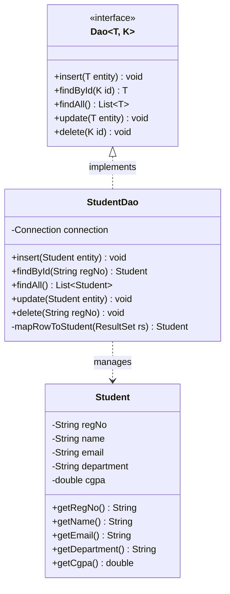

# Task 03 – A3: Data-Access Design Pattern (DAO Pattern)

## Student Details
- **Student Name:** Geetika T
- **Register Number:** 192511469
- **Subject:** Programming in Java (CSA09)
- **Assignment:** Assignment 5 – CO5: Data Persistence Engineering

---

## 1. Scenario Analysis: Common vs. Differing JDBC Steps

When legacy classes like `StudentDB`, `CourseDB`, and `MarksDB` independently execute database operations, severe boilerplate code duplication occurs.

### 1.1 Common Steps (Identical in all JDBC classes):
1. **Connection Lifecycle:** Loading JDBC drivers and obtaining a `Connection` instance from `DriverManager` or a connection pool.
2. **Statement Preparation:** Creating a `PreparedStatement` with parameterized placeholders (`?`).
3. **Execution Pipeline:** Invoking `executeUpdate()` for DML or `executeQuery()` for DQL.
4. **Transaction & Commit Handling:** Disabling auto-commit, managing commit boundaries, and triggering rollbacks on error.
5. **Exception Handling:** Catching and wrapping checked `SQLException` instances.
6. **Resource Cleanup:** Ensuring deterministic closure of `ResultSet`, `PreparedStatement`, and `Connection` via Java's `try-with-resources` idiom.

### 1.2 Differing Steps (Entity-Specific Variations):
1. **SQL Queries:** Different table names (`student`, `course`, `marks`), column structures, and foreign keys.
2. **Parameter Binding:** Binding specific Java datatypes to prepared statement indices (`setString(1, regNo)`, `setInt(2, credits)`, etc.).
3. **Object-Relational Mapping (ORM):** Extracting data from `ResultSet` records to instantiate domain objects (`new Student(...)` vs `new Course(...)`).
4. **Primary Key Type & Strategy:** String/UUID vs Integer auto-increment.

---

## 2. Generic DAO Interface Specification (`Dao<T, K>`)

To eliminate duplication and enforce standard architectural consistency, we define a generic interface:

```java
package Task03;

import java.sql.SQLException;
import java.util.List;

public interface Dao<T, K> {
    void insert(T entity) throws SQLException;
    T findById(K id) throws SQLException;
    List<T> findAll() throws SQLException;
    void update(T entity) throws SQLException;
    void delete(K id) throws SQLException;
}
```
- `T`: The domain model entity type (e.g., `Student`).
- `K`: The primary key lookup type (e.g., `String` for register number).

---

## 3. Student Object-to-Table Mapping

### 3.1 Mapping Schema:
| Student Java Field | Java Type | Database Column Name | SQL Data Type | Key / Constraint | Description |
|:---|:---|:---|:---|:---|:---|
| `regNo` | `String` | `reg_no` | `VARCHAR(20)` | **PRIMARY KEY** | Unique student registration number |
| `name` | `String` | `name` | `VARCHAR(100)`| `NOT NULL` | Student full legal name |
| `email` | `String` | `email` | `VARCHAR(100)`| `NOT NULL UNIQUE` | Institutional email address |
| `department` | `String` | `department` | `VARCHAR(50)` | `NOT NULL` | Academic branch (e.g., "CSE") |
| `cgpa` | `double` | `cgpa` | `DECIMAL(3,2)`| `CHECK (cgpa BETWEEN 0 AND 10)` | Cumulative Grade Point Average |

### 3.2 Primary Key Identification:
- **Primary Key:** `reg_no`
- **Justification:** Every student is assigned an immutable, unique institutional register number (e.g., `192511469`). This serves as the natural primary key ensuring uniqueness without duplicate student entries.

---

## 4. Class and Architecture Diagrams

### 4.1 UML Class Diagram (Mermaid):


### 4.2 Structural ASCII Diagram:
```text
  +-------------------------------------------------------------+
  |                      <<interface>>                          |
  |                       Dao<T, K>                             |
  +-------------------------------------------------------------+
  | + insert(entity: T): void                                   |
  | + findById(id: K): T                                        |
  | + findAll(): List<T>                                        |
  | + update(entity: T): void                                   |
  | + delete(id: K): void                                       |
  +-------------------------------------------------------------+
                                 ^
                                 |  implements
  +-------------------------------------------------------------+
  |                         StudentDao                          |
  +-------------------------------------------------------------+
  | - connection: Connection                                    |
  +-------------------------------------------------------------+
  | + insert(student: Student): void                            |
  | + findById(regNo: String): Student                          |
  | + findAll(): List<Student>                                  |
  | + update(student: Student): void                            |
  | + delete(regNo: String): void                               |
  | - mapRowToStudent(rs: ResultSet): Student                   |
  +-------------------------------------------------------------+
                                 |
                                 v  creates / returns
  +-------------------------------------------------------------+
  |                           Student                           |
  +-------------------------------------------------------------+
  | - regNo: String (PK)                                        |
  | - name: String                                              |
  | - email: String                                             |
  | - department: String                                        |
  | - cgpa: double                                              |
  +-------------------------------------------------------------+
```

---

## 5. Architectural Comparison: Generic DAO vs. Direct SQL in Service/GUI

| Evaluation Factor | Direct SQL in GUI / Service Classes | Generic DAO Pattern Architecture |
|:---|:---|:---|
| **Coupling** | **Tight Coupling:** UI or Service directly depends on SQL strings, table columns, and JDBC drivers. | **Decoupled:** UI interacts solely with domain abstractions (`dao.findById()`). |
| **Code Reusability** | **Extremely Low:** Identical connection management and exception handling replicated across dozens of forms. | **High:** Boilerplate abstracted into generic interfaces and reusable base classes. |
| **Separation of Concerns** | **Violated:** Business logic and presentation layers contaminated with persistence and SQL syntax. | **Strictly Maintained:** Presentation handles UI, Service handles rules, DAO handles storage. |
| **Testability / Mocking** | **Difficult:** Unit tests require a live database; impossible to mock direct JDBC statements easily. | **Trivial:** DAO interfaces can be mocked (`Mockito.mock(Dao.class)`) for isolated unit tests. |
| **Maintenance & Portability** | Schema change in a column requires hunting across thousands of lines of UI code. | Schema modifications isolated to a single DAO implementation class and entity mapping. |
| **Security Risk** | High probability of developers concatenating raw strings in UI forms, inviting SQL Injection. | Centralized `PreparedStatement` usage ensures parameterization by design. |
