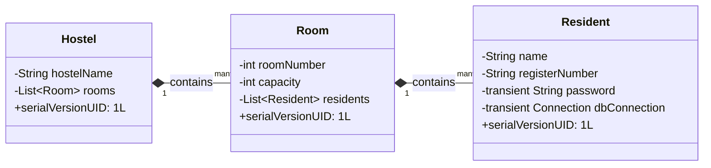

# Task 04 – A4: Serialization Design and Object Graph Analysis

## Student Details
- **Student Name:** Geetika T
- **Register Number:** 192511469
- **Subject:** Programming in Java (CSA09)
- **Assignment:** Assignment 5 – CO5: Data Persistence Engineering

---

## 1. Object Graph Structure and Relationship Diagram

The domain model represents a hierarchical containment graph:
- A `Hostel` contains multiple `Room` objects.
- Each `Room` contains multiple `Resident` objects.
- Each `Resident` possesses: `name`, `registerNumber`, `password`, and a live database `Connection`.

### 1.1 Object Relationship Diagram (Mermaid):


### 1.2 Structural ASCII Hierarchy:
```text
+-------------------------------------------------------------+
|                     Hostel (Serializable)                   |
|  - hostelName: "Cauvery International Hostel"               |
|  - rooms: List<Room>                                        |
+-------------------------------------------------------------+
                               |
                               | 1..* (contains)
                               v
+-------------------------------------------------------------+
|                      Room (Serializable)                    |
|  - roomNumber: 304                                          |
|  - capacity: 2                                              |
|  - residents: List<Resident>                                |
+-------------------------------------------------------------+
                               |
                               | 1..* (contains)
                               v
+-------------------------------------------------------------+
|                    Resident (Serializable)                  |
|  - name: "Geetika T"                                        |
|  - registerNumber: "192511469"                              |
|  - [transient] password: "SecretPassword123"                |
|  - [transient] dbConnection: Connection instance             |
+-------------------------------------------------------------+
```

---

## 2. Transient-Field Decision Table and Technical Justification

In Java serialization, marking an instance field with the `transient` keyword instructs the JVM runtime to skip that field during `ObjectOutputStream.defaultWriteObject()`. Upon deserialization, transient fields automatically initialize to their default JVM type values (`null` for references, `0` for numbers, `false` for booleans).

| Field in Resident | Recommended Modifier | Reason for Decision | Consequence if NOT Marked Transient |
|:---|:---:|:---|:---|
| `name` | Normal (Serializable) | Represents persistent demographic student identity. | Deserializes accurately; expected behavior. |
| `registerNumber` | Normal (Serializable) | Natural unique identifier for student record. | Deserializes accurately; expected behavior. |
| `password` | **`transient`** | **Security Vulnerability:** Plaintext passwords serialized to disk can be inspected or extracted with binary analysis tools. | Exposes sensitive user credentials on persistent storage without hashing or encryption. |
| `dbConnection` | **`transient`** | **Runtime Native Handle:** A live `java.sql.Connection` encapsulates ephemeral OS TCP sockets, network file descriptors, and server-side session state that cannot exist across JVM restarts. | **Fatal Runtime Crash:** `java.sql.Connection` does NOT implement `java.io.Serializable`. Serialization immediately crashes with `java.io.NotSerializableException: com.mysql.cj.jdbc.ConnectionImpl`. |

---

## 3. Object Graph Serialization Mechanism

When `objectOutputStream.writeObject(hostel)` is invoked:
1. **Recursive Graph Traversal:** The serialization engine traverses the object graph starting from the root `Hostel` instance using depth-first reachability.
2. **Type Validation:** Every traversed class (`Hostel`, `Room`, `Resident`, and standard collections like `ArrayList`) MUST implement `java.io.Serializable`. If any non-transient reachable object fails this test, a `NotSerializableException` is thrown and the operation is aborted.
3. **Reference Handle Tracking:** The stream maintains an internal identity hash map of already serialized objects. If two rooms reference the same resident or if circular references exist, Java writes an object handle (back-reference ID) rather than duplicating the object, preventing infinite loops and maintaining graph topology.
4. **Metadata Header:** Stream writes standard header tokens (`AC ED 00 05` - magic number and stream version), class descriptor signatures, field types, and `serialVersionUID` values.

---

## 4. Class Schema Evolution: Adding a New Field (`phoneNumber`)

### Scenario:
A new field `private String phoneNumber;` is added to `Resident` after legacy `.ser` files have already been written to disk.

### 4.1 Case A: `serialVersionUID` is NOT Explicitly Defined
- When omitted, the Java compiler automatically computes a 64-bit hash based on class structure (class name, interfaces, method signatures, field names, and modifiers).
- Adding `phoneNumber` alters the generated hash value.
- When an old serialized file is deserialized using the updated class, the JVM detects a hash mismatch:
  $$\text{Old Class Hash } (0x7F2A...) \neq \text{ New Class Hash } (0x9B1E...)$$
- **Result:** Deserialization immediately crashes with `java.io.InvalidClassException: Resident; local class incompatible: stream classdesc serialVersionUID = ..., local class serialVersionUID = ...`.

### 4.2 Case B: `serialVersionUID` IS Explicitly Declared (`private static final long serialVersionUID = 1L;`)
- The JVM detects identical `serialVersionUID` values and permits deserialization.
- The runtime reads existing fields (`name`, `registerNumber`) normally.
- The newly added field (`phoneNumber`), missing in the old serialized stream, is safely populated with its default JVM value (`null`).
- **Result:** Complete backward compatibility is maintained without data loss or application crashes.

---

## 5. Comparative Evaluation: Java Serialization vs. CSV vs. JSON

| Architectural Criterion | Java Native Serialization | Comma-Separated Values (CSV) | JavaScript Object Notation (JSON) |
|:---|:---|:---|:---|
| **Human Readability** | Binary format; unreadable without specialized parsers. | Plain text tabular; fully readable in notepad and Excel. | Human-readable key-value text; intuitive and structured. |
| **Language Interoperability** | **Proprietary to Java;** virtually impossible for C++, Python, or Go to consume directly. | Universal; supported natively by all programming languages and databases. | **Universal Industry Standard;** native support in web, mobile, and backend microservices. |
| **Security & Vulnerabilities** | **Severe Risk:** Remote Code Execution (RCE) via Deserialization Gadget Chains (`readObject()` abuse). | Safe; data only (no bytecode or reflective class instantiations). | Safe; standardized schemas (Jackson/Gson) with strict type validation. |
| **Schema Evolution** | Brittle; requires strict `serialVersionUID` tracking and custom `readObject()` handlers. | Fragile; adding a column can shift token indexes if order changes. | **Robust:** Fields can be added or omitted freely without breaking older clients. |
| **Payload Size & Efficiency** | Compact binary, but includes heavy JVM metadata and class signatures. | Extremely compact for flat tabular records. | Moderate; key names repeated per record, but highly compressible (gzip). |
| **Complex Graphs / Nesting** | Built-in recursive object graph and cycle preservation. | Incapable of representing nested collections or object graphs cleanly. | Supports hierarchical trees cleanly; cyclical references require custom ID resolvers. |
| **Industry Recommendation** | **Deprecated / Discouraged** for network APIs or long-term persistence. | Ideal for tabular data exports, bulk reporting, and simple logs. | **Highly Recommended** for APIs, inter-service messaging, and document persistence. |
